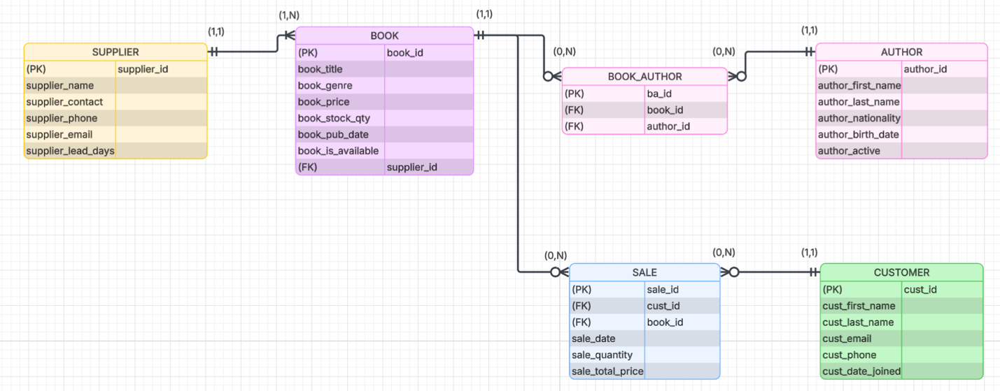

# Bookstore Relational Database

A MySQL database for a retail bookstore that tracks inventory, customers, authors, suppliers, and sales, designed from mission statement to working queries.

Team project for **Applied Database Design (LIS 464), UW–Madison, Spring 2026**, built with Diya Kothari and Yash Arvind.

## Design

**Tables:** `Supplier`, `Book`, `Customer`, `Author`, `Sale`, and the linking table `Book_Author`.

**Relationships**

- A supplier supplies zero or many books; every book has exactly one supplier.
- A customer makes zero or many sales; every sale belongs to one customer.
- A book appears in zero or many sales; every sale includes one book.
- Books and authors are many-to-many, resolved through `Book_Author`.

**Business rules** are enforced through keys and defaults. For example, a sale can't be recorded without an existing customer, and a book with no stock can't be marked available.

The schema uses integer, string, date, decimal, boolean (`TINYINT(1)`), `ENUM`, and auto-increment fields, with defaults set on price, stock, genre, and join date.

## Queries

`sql/queries.sql` has seven reporting queries, including:

- multi-table joins (books with their authors and suppliers, customer purchase history),
- `GROUP BY` aggregations (total spent per customer, books sold and average price per genre).

## Files

- `sql/schema.sql` — `CREATE TABLE` statements with primary keys, foreign keys, and defaults.
- `sql/queries.sql` — reporting queries.
- `docs/erd.png` — entity-relationship diagram.
